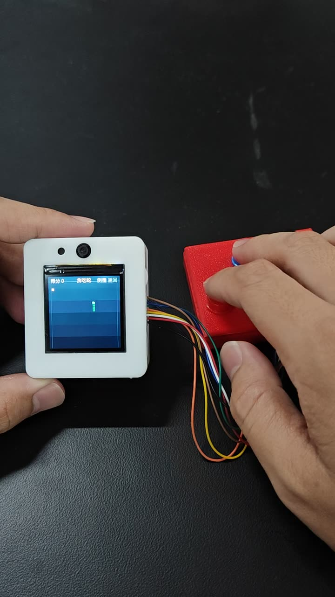
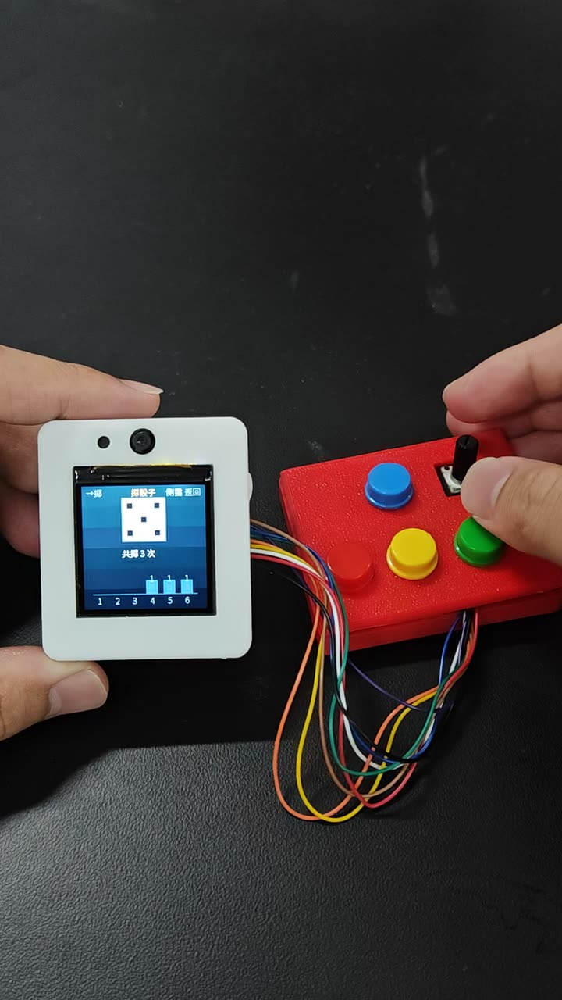
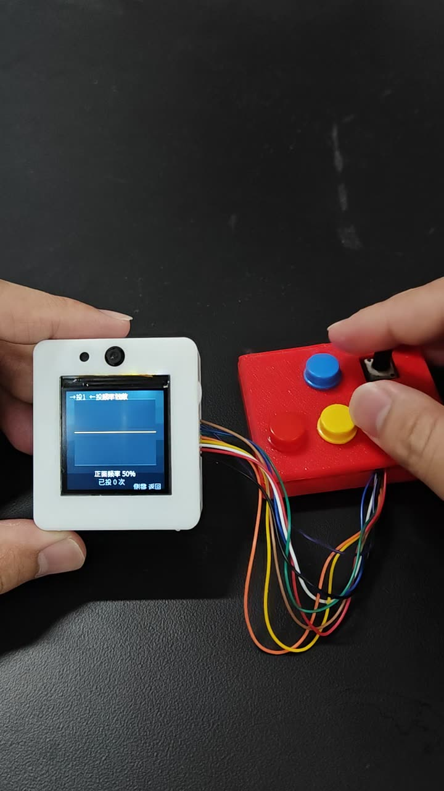

# 概率论助教与小游戏 · Arcs Mini3

对着掌机说"掷个骰子"，助教**小概**会先讲两句直觉，再把小游戏直接拉到屏幕上；退出游戏，接着聊概念。

一套跑在 **聆思 Arcs Mini3**（240×240 圆屏）上的：语音概率论助教 + 13 个画面的 Lua 小游戏与教学实验，外加一层让"声音、画面、按键"真正好用的固件增强。

> **非官方项目**，与聆思（ListenAI）无隶属关系，仅为适配 Arcs Mini3 平台而开发。
>
> An unofficial probability-tutor + mini-game collection for the ListenAI Arcs Mini3 handheld (240×240 round LCD): 13 Lua scenes, 26 procedural SFX scores, and firmware patches adding a 4-voice synth binding, `tts.speak()`, `app.exit()`, and on-device screen/key/glyph/audio inspection commands.

---

## 效果

<table>
  <tr>
    <td></td>
    <td></td>
    <td></td>
  </tr>
  <tr>
    <td align="center">贪吃蛇（像素级连续移动）</td>
    <td align="center">掷骰子（抖动 + 滚动乐谱）</td>
    <td align="center">掷硬币（频率统计）</td>
  </tr>
</table>

> 原型机：机身 + 3D 打印扩展板。扩展板上是 **4 个方向键 + 1 个旋钮**（第 5 个按键是机身自带的侧键，不在这块板上），杜邦线接到主控排针。外壳 STEP 在 [`hardware/`](hardware/)。

---

## 目录

- [效果](#效果)
- [它是什么](#它是什么)
- [它能做什么](#它能做什么)
- [硬件与 BOM](#硬件与-bom)
- [为什么需要这些固件补丁](#为什么需要这些固件补丁)
- [仓库结构](#仓库结构)
- [快速开始](#快速开始)
- [开发与调试](#开发与调试)
- [音效是怎么做的](#音效是怎么做的)
- [已知限制](#已知限制)
- [许可证与致谢](#许可证与致谢)

---

## 它是什么

两半，各自能独立用，合起来才是完整的东西。

### 一半是助教

唤醒后直接问："为什么掷 10 次硬币不一定 5 正 5 反？""高尔顿板为什么会长成钟形？"

- **人设"小概"**：像个爱跟学生打赌的学长，先给一句"直觉版"再展开。不堆公式——这是语音 + 小屏幕场景，长公式既听不清也显示不下。
- **知识库**：按课程的"知识单元"切分，讲概念时按单元检索。
- **会动手**：讲到该做实验了，直接把小游戏拉到屏幕上。

| 学生说 | 助教调用 | 屏幕上出现 |
|---|---|---|
| 掷个骰子 / 来一局 | `play_dice` | 单颗 d6，滚动动画 + 落点直方图 |
| 抛硬币 / 看正面频率 | `play_coin` | 正反累计与占比 |
| 高尔顿板 / 放小球 | `play_galton` | 小球逐个撞钉入槽，堆成直方图 |
| 打开游戏厅 | `play_arcade` | 5 个游戏的主菜单 |
| 测一下接线 / 硬件测试 | `play_hwtest` | 按键电平与旋钮读数的实时自检 |
| 退出 / 回桌面 | `ls.built_in.miniapp_exit` | 回到待机 |

人设与行为规范原文在 [`assistant/`](assistant/)，可以直接改。语音编排层基于聆思官方 voice-chat 模板（不包含在本仓库）；本仓库提供的是**人设 + 小游戏 + 把这 5 个工具接上固件的实现**。

### 另一半是小游戏

不接语音也能独立跑：`miniapp run arcade` 就是一个完整的掌机游戏厅。

```
游戏大厅
├── 贪吃蛇
├── 概率实验室
│   ├── 掷骰子        单颗 d6，滚动动画 + 落点统计
│   ├── 掷硬币        正反累计、大数定律可视化
│   ├── 高尔顿板      小球下落、撞钉、入槽形成直方图
│   ├── 频率收敛      理论概率 vs 实测频率曲线
│   ├── 蒲丰投针      投针算圆周率；双视图看"交不交"和"怎么逼近 3.1416"
│   ├── 蒙提霍尔      三扇门，可换门；跑一批实验看换门胜率
│   └── 二项分布      n/p 可调，柱状图与理论值对照
├── 平衡挑战          旋钮反向补偿，杆越斜倒得越快
├── 打靶              5 发，每发准星随机落点，旋钮微调
└── 2048              4×4 合并，达成 2048 有专属旋律
```

**进游戏会念一段玩法说明**。基于运行时的 `tts.speak()`：异步、不阻塞，播报期间手照样能按，讲完自动恢复游戏音效。

---

## 它能做什么

方向键选择、`→` 进入；板载侧键单击返回上级，在主菜单上则退出小应用。

| 场景 | 操作 | 关键实现 |
|---|---|---|
| 贪吃蛇 | ↑↓←→ 转向 | 像素级连续移动（不是整格跳），转向当帧生效；体节按轨迹等距铺开 |
| 概率实验室 | ↑↓ 选项，→ 进入 | 7 个统计/概率小实验共用一套菜单与返回栈 |
| 蒲丰投针 | ↑投 1 根、↓投 10 根、←切旋钮参数、→换视图 | 红=扎到平行线、蓝=没扎到；旋钮调针长/线距；视图 2 是 π 的收敛折线（黄线 3.1416）。一帧图元有限，屏上只画最近 160 根，`共 N` 照常累加 |
| 平衡挑战 | 旋钮 | 按**秒**积分（`acc = off*300 + 噪声1100`），不操作约 20 秒落杆；分数 = 存活 0.1 秒 |
| 打靶 | 旋钮微调 + → 发射 | 每发准星在 44..196 随机重置，旋钮做**相对**微调，落点带 ±11px 抖动；10/8/6/4/2 环 |
| 2048 | ↑↓←→ 滑动 | 44px 格 + 4px 间距，按合并值升调的音效，无路可走才判负 |

另有四个独立小应用，可作为最小示例阅读：

- `apps/dice.lua` — 独立掷骰子，抖动动画 + 830ms 滚动乐谱
- `apps/coin.lua` — 掷硬币，正反累计
- `apps/galton.lua` — 高尔顿板
- `apps/hwtest.lua` — 硬件自检：按键电平、旋钮 ADC、屏幕色块

---

## 硬件与 BOM

| 部件 | 型号 / 规格 | 说明 |
|---|---|---|
| 主控 | 聆思 Arcs Mini3（LS2663） | 240×240 圆屏、麦克风、扬声器、Wi-Fi |
| 扩展 IO | CH32V003（I2C 桥） | 提供 `exgpiod` / `exadc`，扩展板经排线接到主控 |
| 方向键 ×4（扩展板上） | **Risym 大按键模块**：12×12mm 轻触开关 + 大圆帽（黑/红/绿/蓝/黄） | 20×12mm PCB，3Pin `VCC/GND/OUT`，3.3–5V，板载上拉 + 防抖；**高电平有效**（部分版本可跳线选低有效） |
| 功能键 ×1（机身自带） | 开发板自带的侧键，**不在扩展板上、不用买** | `on_button_click("function")` 回调：游戏厅里是「返回 / 退出」，独立的骰子·硬币·高尔顿应用里是「掷一次 / 放一球」（长按 3 秒退出） |
| 旋钮 ×1 | **Risym 电子积木 旋转电位器模块**：10kΩ 线性，机械行程 270° | 20×20mm PCB（带 Φ3mm 安装孔），3Pin `GND/VCC/OUT`，输出 0–VCC 模拟电压；10 位 ADC → 1024 级 |
| 外壳 | 自绘 3D 打印：底座 64×54×9mm + 盖板 64×54×3mm | 见 [`hardware/`](hardware/)（STEP AP214，可直接切片） |

**两个模块恰好对上两类接口**：按键给"高/低电平"（数字输入），旋钮给"0 到 VCC 的电压"（ADC 输入）。代码里 `(k - 512) / 512` 把 0..1023 映射到 -1..1，正对应 270° 行程与线性电位器的关系——这也是"旋钮只能读绝对位置、不知道转了几格"的物理原因。

| 信号 | 引脚 |
|---|---|
| ↑ | PB7（高有效） |
| ↓ | PA0（高有效） |
| ← | PB6（高有效） |
| → | PA1（高有效） |
| 旋钮 | PD4 → `exadc` ch7，0..1023 |
| 屏幕 | 240×240，Lua 侧 `app.width/height = 240` |
| 字体 | `lv_font_chinese_16.bin`，1bpp，cmap 含 U+2190..U+2199 箭头 |
| 基础固件 | 聆思 arc SDK `mini-v3.1.0` 分支 |

> 引脚和外壳上的丝印顺序是交叉的（上=PB7、下=PA0），早期版本按丝印顺序写，结果"按上出下、按左出右"。以上是 2026-11 按实测改正后的映射；如果你照自己的接线改过，只需同步 [`apps/hwtest.lua`](apps/hwtest.lua) 与 `mcp_tool_miniapp_builtin.c` 里的 `miniapp key` 映射。
| Lua 方言 | 精简 Lua：无 `pcall`，`screen.*` 只收整数 |

---

## 为什么需要这些固件补丁

原厂固件能跑 Lua，但做游戏时会撞到四面墙。补丁 `patches/0001-miniapp-arcade-runtime.patch` 逐个拆掉：

| 问题 | 现象 | 补丁做法 |
|---|---|---|
| 只有单音 `buzzer.play(hz, ms)` | 每次调用都**重开一条音频流**；60ms 内连发两次会互相打断，两条都听不见 | 暴露 `synth.play(notes)`：4 声部、方波/三角/噪声、按毫秒排时间轴，一次提交整段 |
| 小应用无法主动退出 | 只能靠外部命令停掉 | 绑定 `app.exit()`，投递 `MINIAPP_EVENT_EXIT`（不在回调里拆 VM） |
| 屏幕内容看不见 | 只能靠肉眼判断渲染对不对 | `miniapp screen` 把最近一帧结构化打印出来 |
| 按键/字形没法验证 | 只能猜引脚或字体有没有 | `miniapp key <dir> <0\|1>` 注入按键、`miniapp glyph <hex>` 查 cmap |
| 音频是否真的播完 | Lua 没报错 ≠ 出声 | `miniapp audio` 输出播完段数、音符数、最近一段时长、是否正在播；第二行是 TTS 的请求数/成功数/最近状态 |
| 小应用想主动说话 | 只有对话链路，游戏里没法念玩法 | 暴露 `tts.speak(text)`（异步、不阻塞，结果走 `on_tts_result(id, {...})`），并加 `MINIAPP_TTS_MAX_PENDING = 1` 的单请求排队 |
| 一帧文字上限 16 | 2048 需要 16 格数字，加上分数就超 | `MINIAPP_MAX_TEXTS` 16 → 32 |
| Lua 堆偏小 | 大源码 + 双 VM 回滚时紧张 | `MINIAPP_HEAP_MAX_BYTES` 默认 384KB → 512KB |
| 源码上限 64KB | `arcade.lua` 涨到 72KB 时安装失败 | `MINIAPP_SOURCE_MAX_BYTES` 默认 64KB → 96KB（上限 128KB） |

补丁共 10 个文件、约 1300 行，全部围绕 `apps/arcs-mini/miniapp/`、`apps/arcs-mini/mcp-tools/` 和 `src/shell/cmd/`。

---

## 仓库结构

```
apps/        可直接装进设备的 Lua 小应用
assistant/   助教"小概"的人设与行为规范
tools/       gen_builtin.py（Lua → C 字节数组）、sim_*.cjs（PC 端无头仿真）
patches/     相对官方 mini-v3.1.0 的固件补丁
docs/        开发记录、踩坑记录、字体与输入速查
hardware/    底座 + 盖板 STEP、外形预览、打印与装配说明
```

---

## 快速开始

### 路线 A：只装 Lua 应用（不改固件）

需要设备上已有带 `synth.play` 和 `app.exit` 的固件（即先走路线 B）。把 `apps/arcade.lua` 推到设备或通过 `ling` 部署，然后：

```sh
adb shell miniapp run arcade
```

### 路线 B：打补丁 + 重编固件

```sh
# 1. 从聆思开发者平台获取 arc SDK（arcs_mini 仓库），检出 mini-v3.1.0
git clone <SDK 仓库地址> arcs_mini && cd arcs_mini
git checkout mini-v3.1.0

# 2. 打补丁
git apply <本仓库>/patches/0001-miniapp-arcade-runtime.patch

# 3. 把 Lua 源码生成 C 字节数组，直接写进 SDK 的 mcp-tools/
#    在本仓库根目录执行：
python tools/gen_builtin.py --src apps --out ../arcs_mini/apps/arcs-mini/mcp-tools

# 4. 编译
ninja -C build

# 5. 烧录（进恢复模式后推 bin 到 NAND 起始偏移）
adb shell recovery
adb -s BOOT-<serial> push build/arcs-mini.bin /RAW/NAND/600000
adb -s BOOT-<serial> shell reboot hard
```

> `gen_builtin.py` 默认输出到 `../apps/arcs-mini/mcp-tools`，可用 `--out` 指定。补丁里的 `mcp_tool_miniapp_builtin.c` 会 `#include` 这些生成的头文件，**必须先跑第 3 步再编译**。

### 路线 C：只要助教

把 [`assistant/persona.md`](assistant/persona.md) 与 [`assistant/system-prompt.md`](assistant/system-prompt.md) 的内容贴进聆思平台的"角色配置"和"系统提示词"即可。小游戏工具依赖路线 B 的固件。

---

## 开发与调试

### PC 端无头仿真

改 Lua 最痛的是"烧进去才发现崩了"。`tools/sim_arcade.cjs` 用 fengari 跑真实源码，假屏幕**严格复刻 C 层校验**——整数、`w/h>=1`、矩形不越界、`text` 的 y≤224、一帧 32 条文字上限：

```sh
cd tools && npm install          # 只装 fengari；有 package-lock 时可用 npm ci
node sim_arcade.cjs ../apps/arcade.lua
node sim_dice.cjs  ../apps/dice.lua
```

它对 13 个页面做「旋钮全量程 + 随机按键 80 帧」压力测试。这一层直接抓到过两个真机崩溃：平衡挑战的浮点参数、打靶弹孔的 `h.x-2`。

### 设备端自检命令

```
miniapp list                列出已注册小应用
miniapp run <id>            启动
miniapp status              帧数、掉帧、最大帧耗时、last_error
miniapp key <dir> <0|1>     注入按键（up/down/left/right）
miniapp btn                 模拟侧键单击
miniapp screen              打印最近一帧的图形与文字（图元 >64 个时只打末尾 32 条，好让折线末端不被截断）
miniapp glyph <hex...>      查字形位图与步进（如 2190 2191 2192 2193）
miniapp audio               合成器遥测：播完段数/音符数/最近时长/是否在播；第二行是 TTS 请求数/成功数/最近状态
```

`miniapp screen` + `miniapp audio` 的组合，让"画面对不对、声音出没出"都能在 headless 的 ADB 会话里验证，不用盯着屏幕。

---

## 音效是怎么做的

`apps/arcade.lua` 顶部有一个小音效引擎：把每个音效写成音符表 `N(delay_ms, hz, dur_ms, voice, wave, volume)`，`synth.play` 一次提交整段，避免多次开流互相打断。

```lua
gun = {                       -- 枪声：噪声爆音 + 低频冲击 + 余震
  N(0,   4300,  30, 1, "noise",   70),
  N(0,    270,  60, 2, "square",  60),
  N(30,  1500,  50, 1, "noise",   45),
  N(70,   105, 110, 3, "square",  50),
}
```

- **骰子滚动**是一段 830ms 的乐谱：13 下撞击、间隔逐渐拉长（越滚越慢），配 3 下低频闷响；落定再单独一声。
- **枪声 + 命中提示**用 `join_score` 拼成一条（枪响后 170ms 接琶音），分两次提交会互相掐断。
- 2048 的合并音按块值升调：2/4/8/16/32 各一个音，滑动的噪声很轻，连滑不吵。

共 26 组乐谱（外加 4 个拼接变体，实际可播 30 种）：菜单移动/确认/返回/拒绝、吃与死亡、落杆、十环/八环/四环/脱靶、硬币、放球/撞钉/入槽、滑动/合并/达成、蒙提霍尔输赢。

---

## 已知限制

- **源码上限 96KB**：`arcade.lua` 已 72KB（Kconfig 默认值已从 64KB 调到 96KB），再加内容要留意；文字一帧 32 条也接近上限。
- **一帧最多 256 个图元**：蒲丰投针因此屏上只画最近 160 根针，统计仍按全部针数算，屏幕用 `共 N` 标出总数——不是针丢了，是画不下。
- **旋钮是电位器不是编码器**：270° 机械行程、无档位，读不到"转了几格"，所有旋钮交互都要自己做基线与相对量。
- **无 `pcall`**：设备端 Lua 不给 `pcall`，任何可能越界的参数都得在调用前夹取，否则直接抛错中断安装。
- **仿真器不是真机**：屏幕校验逻辑照抄 C，但时序、字体渲染、音频输出仍需真机确认。
- `miniapp` 系列调试命令会常驻固件，发布版建议用 Kconfig 裁掉。
- 助教的语音链路依赖聆思云平台，离线不可用。

---

## 许可证与致谢

- 本仓库自有内容（`apps/`、`assistant/`、`tools/`、`docs/`）以 MIT 发布，见 [LICENSE](LICENSE)。
- `patches/` 是对**聆思官方 arc SDK** 的修改。官方 SDK 未附带开源许可证文件，因此本仓库只分发 diff，不 redistribute 任何官方源码；使用补丁前请自行获取 SDK 并遵守其条款。
- 按键与旋钮模块来自 Risym（risym.tmall.com），规格摘自其公开的商品文档。
- 感谢聆思（ListenAI）提供硬件、SDK 与 `ling` 工具链。
