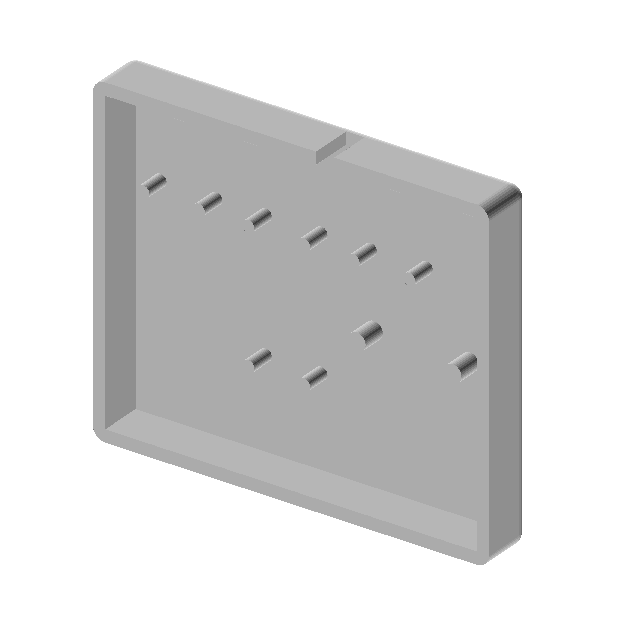
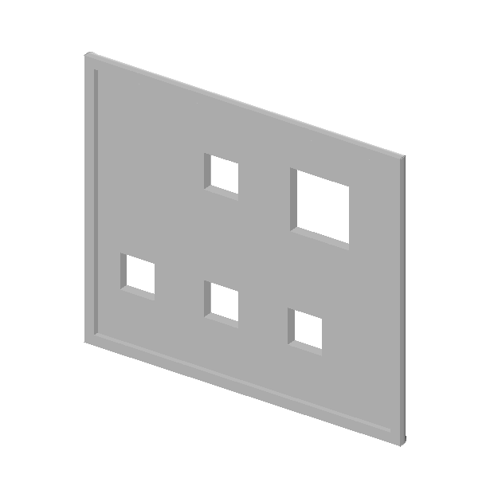

# 扩展板外壳（底座 + 盖板）

按键/旋钮**扩展板**的两件式外壳，3D 打印，螺丝扣合。

## 这块板装什么

| 元件 | 数量 | 位置 |
|---|---|---|
| 方向键模块（Risym 大按键） | 4 | 盖板上的 4 个 7×7 mm 小窗 |
| 旋钮模块（10kΩ 电位器） | 1 | 盖板上的 12×12 mm 大窗 |

> 第 5 个按键是**机身自带的侧键**（功能键，走 `on_button_click("function")`），不在这块板上，所以盖板只有 5 个窗而不是 6 个。

| 文件 | 说明 | 外形 |
|---|---|---|
| `base.step` | 底座（托板） | 64 × 54 × 9 mm |
| `lid.step` | 盖板（面板） | 64 × 54 × 3 mm |

> 两件都是 **单实体、STEP AP214**，由 SolidWorks 2022 导出。任何 CAD（Fusion / FreeCAD / OnShape）都能打开，切片软件也能直接读 `.step`。
> 原始 `.SLDPRT` 未放入仓库；需要的话开 issue。

## 实测尺寸

用脚本从 STEP 实体里读的（`CARTESIAN_POINT` 包围盒 + `CYLINDRICAL_SURFACE` 轴线），不是估的：

**底座 `base.step`**

| 项 | 值 |
|---|---|
| 外形 | 64 × 54 × 9 mm |
| 外圆角 | R2（四角） |
| 底板孔 | 10 × Φ2，两排各 5 个，位于 z = ±10.5 |
| 螺纹底孔 | 2 × Φ2.9（M3 自攻），位于 (8.5, −1.5)、(24, −1.5) |
| 顶部 | 一侧留缺口（走线用） |

**盖板 `lid.step`**

| 项 | 值 |
|---|---|
| 外形 | 64 × 54 × 3 mm |
| 开窗 | 5 个方窗：4 × 7×7 mm（按键）+ 1 × 12×12 mm（旋钮） |

窗的相对位置（原点 = 零件包围盒中心，X 向右、Z 向上，单位 mm）：

| 窗 | 尺寸 | 中心 | 对应 |
|---|---|---|---|
| 按键 1 | 7 × 7 | (−22.0, −12.0) | 下排左 |
| 按键 2 | 7 × 7 | (−5.0, −12.0) | 下排中 |
| 按键 3 | 7 × 7 | (+12.0, −12.0) | 下排右 |
| 按键 4 | 7 × 7 | (−5.0, +12.0) | 中列上（正对按键 2 上方 24 mm） |
| 旋钮 | 12 × 12 | (+15.0, +12.0) | 右上角 |

下排三个按键间距 17 mm；第 4 个在中列正上方；旋钮窗在右上，离最近的按键窗 10 mm。

## 打印建议

| 项 | 建议值 |
|---|---|
| 材料 | PLA（展示件） / PETG（要摔的话） |
| 层高 | 0.2 mm |
| 填充 | 15–20% |
| 壁厚 | ≥ 3 道 |
| 支撑 | 盖板开窗不需要；底座平放（开口朝上）也不用支撑 |
| 摆放 | 盖板正面朝上直接打；底座底面贴床 |

## 装配

1. 先把 4 个按键模块、1 个旋钮模块用 M3 自攻螺丝拧到底座底板上（Φ2.9 底孔，自攻进塑料，别一次拧到底，回半圈再拧）。
2. 杜邦线从底座侧面的缺口引出，接到主控排针。
3. 盖板对位后压合，逐个试按：每个键都能按到底、旋钮能自由转满 270°、不刮到窗边。
4. 装之前先干配一次，别带着模块硬压。

## 注意

- 底座底板那两排 Φ2 孔是照模块的引脚/走线位置开的，接不同模块时可能要按实际接线调一下。
- 盖板只有 3 mm，反复拆装容易把自攻牙孔磨滑；要经常拆的话建议换成 M3 热熔铜螺母。
- 孔径是按 FDM 打印的收缩补偿给的最小值，打印机精度差的话先用 Φ3 铰刀过一遍。
